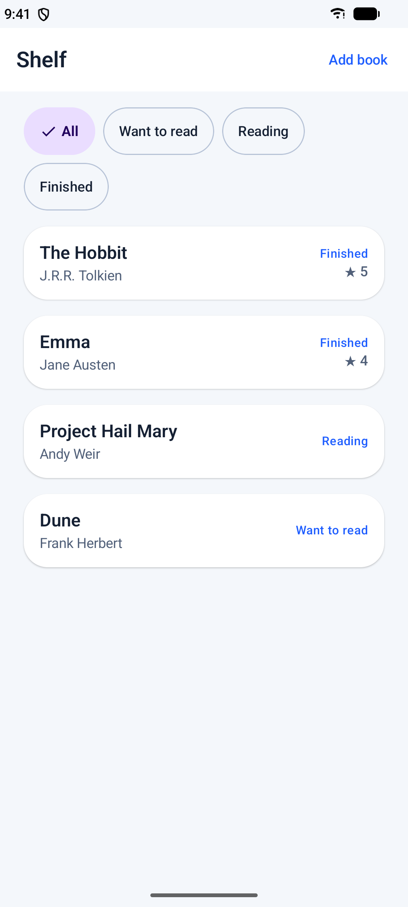
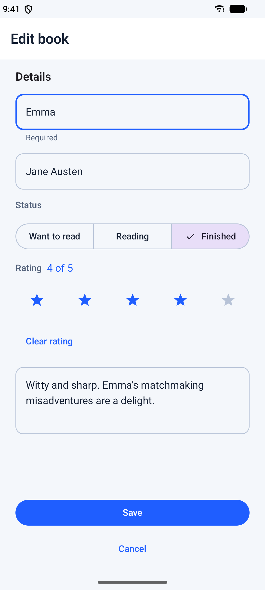
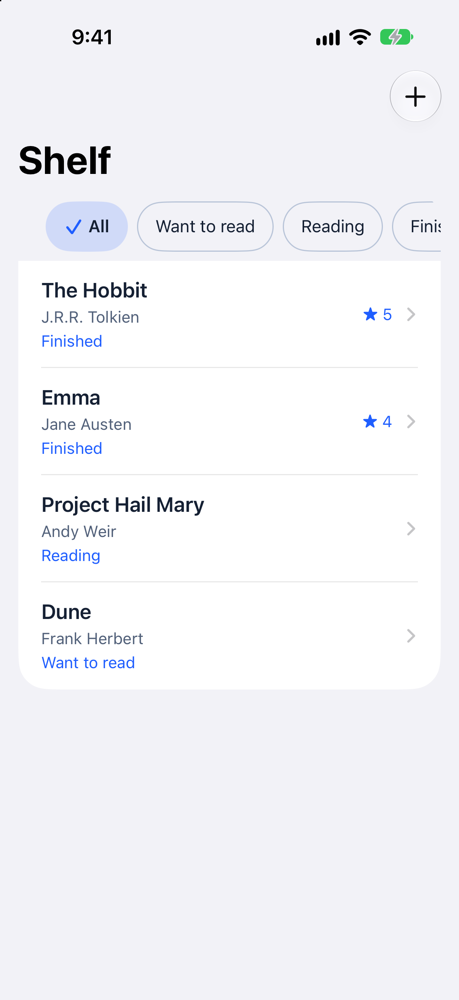
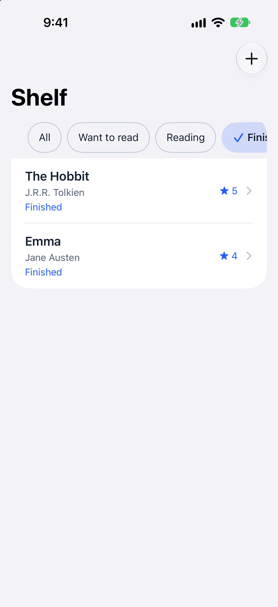
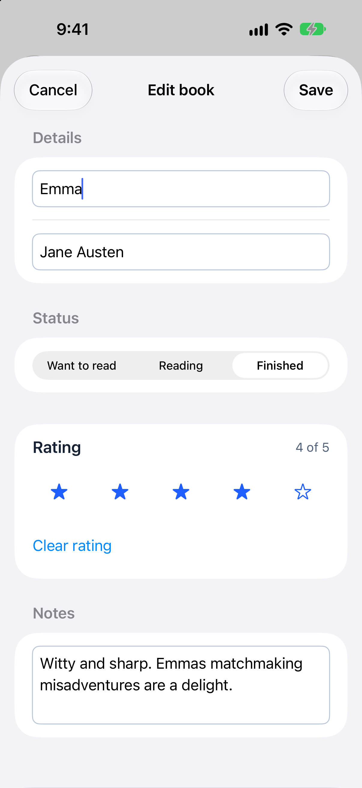

# Shelf

A small, local-only reading log for **Android** (Jetpack Compose) and **iOS** (SwiftUI), built with Kotlin Multiplatform. Keep track of what you want to read, what you are reading, and what you have finished, with a rating and your own notes. No accounts, no network: everything stays on the device.

## Screenshots

### Android

| Shelf | Filtered | Book details | Edit book |
|:---:|:---:|:---:|:---:|
|  |  |  |  |

### iOS

| Shelf | Filtered | Book details | Edit book |
|:---:|:---:|:---:|:---:|
|  |  |  |  |

## Features

- Add, edit and delete books (delete asks for confirmation).
- Each book has a title (required), an optional author, a status (**Want to read**, **Reading**, **Finished**), a **1-5 rating** (Finished books only) and free-text notes.
- Filter the shelf by status; the list shows the rating of finished books.
- Tap a book to open its detail screen.
- Data is stored locally with Room (`shelf_book.db`); there is no sync and no sign-in.

Business rules:

- A title is required.
- A rating must be between 1 and 5. Changing a book away from Finished clears its rating.

## Architecture

Shared Kotlin holds the business logic; each platform has its own native UI.

- **Android UI:** Jetpack Compose, Navigation 3, Koin.
- **iOS UI:** native SwiftUI in `iosApp/`, talking to the shared Kotlin code through a small bridge.
- **Layers:** `Presentation -> Domain <- Data`. The domain layer is pure Kotlin.

```
androidApp/              Android app shell
iosApp/                  iOS app shell and SwiftUI screens (iosApp/src/Book)
feature/
  book-domain/           models, validation, repository interface, use cases
  book-data/             Room database and repository implementation
  book-api/              the feature's public navigation contract
  book-impl/             Compose screens, ViewModels, DI wiring
shared/
  core-*/                shared domain, data, presentation, strings and test helpers
  designsystem/          theme and reusable Compose components
  navigation/            central navigation
  umbrella-*/            modules re-exported to iOS and the apps
maestro/                 end-to-end UI flows for both platforms
specs/book/              plan, contract, UI spec, verification report, retrospective
```

## Build and run

Shelf builds with the [JetBrains Kotlin Toolchain](https://kotlinlang.org/) (`./kotlin`, Alpha). There is no Gradle.

Requirements: JDK, the Android SDK, and Xcode for iOS.

```bash
./kotlin build                                       # build all modules
./kotlin test --platform=android                     # Kotlin tests on Android
./kotlin test --platform=iosSimulatorArm64           # Kotlin tests on the iOS simulator
./kotlin build -m androidApp --platform=android      # Android app
./kotlin build -m iosApp --platform=iosSimulatorArm64  # iOS app (simulator)
```

Run a single module's tests while iterating:

```bash
./kotlin test -m book-impl --platform=android
```

To run the iOS Swift tests:

```bash
xcodebuild test -project iosApp/module.xcodeproj -scheme iosApp \
  -destination 'platform=iOS Simulator,name=<an installed simulator>' CODE_SIGNING_ALLOWED=NO
```

## Testing

- Kotlin unit tests for the domain, data and presentation layers.
- Swift unit tests in `iosApp/test`.
- End-to-end [Maestro](https://maestro.mobile.dev/) flows in `maestro/features/book/` (`android.yaml`, `ios.yaml`) covering add, rate, notes, detail, edit, filter and delete. See `maestro/README.md`.
- A feature gate script: `.opencode/scripts/verify-feature.sh book` checks structure, wiring, strings, builds and tests.

## Project status

The `book` feature is complete and was reviewed against its contract in `specs/book/`. `specs/verification-report.md` lists what was verified and what was not, including accessibility (TalkBack, VoiceOver), Dynamic Type at large sizes and dark mode, which have not been checked yet.

The Kotlin Toolchain is Alpha, so expect rough edges in the build tooling.
